<!-- ───────────────────────────── HERO ───────────────────────────── -->
<a href="https://www.ashishk.online">
  <picture>
    <source media="(max-width: 600px)" srcset="./assets/hero-mobile.svg" />
    
  </picture>
</a>

<p align="center">
  <a href="https://www.ashishk.online"></a>
  <a href="https://www.linkedin.com/in/ashish-kumar-nitp/"></a>
  <a href="mailto:kumarashish98526@gmail.com"></a>
</p>

<p align="center">
  
  
  
  
</p>

## 👨‍💻 About Me

I build **production web platforms** and the **infrastructure they run on** — from Next.js front ends and Fastify APIs down to firewalls, tunnels and storage. I'm doing a **Dual Degree (B.Tech + M.Tech) in CSE at NIT Patna**, where I lead development of the institute's web platforms. My M.Tech research is in **malware & ransomware detection**.

<p align="center">
  
  
</p>

```js
const ashish = {
  role: "Full-Stack Engineer",
  ships: "EdTech + self-hosted infra",
  research: "XAI ransomware detection",
  stack: ["Next.js", "Fastify",
    "PostgreSQL", "Redis", "Docker"],
  networks: ["NGFW", "SD-WAN",
    "WireGuard", "Cloudflare Tunnel"],
  tinkers: ["ESP32", "IoT", "GPUs"],
  motto: "Automate it. Then twice.",
};
```

## 🧰 Tech Stack

<p align="center"><b>Languages</b><br/><br/>
  
</p>

<p align="center"><b>Frontend</b><br/><br/>
  
</p>

<p align="center"><b>Backend & Data</b><br/><br/>
  <br/>
  
  
  
</p>

<p align="center"><b>DevOps, Networking & Hardware</b><br/><br/>
  <br/>
  
  
  
  
  
</p>

## 💼 Experience

<details open>
<summary><b>🚀 Software Developer & Architect — Eduteria Edutech Pvt. Ltd.</b></summary>
<br/>

EdTech platform for competitive-exam preparation (BPSC, UPSC & state exams) serving students across Bihar and UP.

- Architected a **multi-tenant video & live-streaming platform** for classes and recorded content
- Built an **OMR exam management system** with barcode sheet tracking and offline verification
- Shipped **WhatsApp Business automation** and background job pipelines on **BullMQ + Redis**
- Built **Slide Studio** — automated PowerPoint generation for MCQ decks
- Designing a **multi-agent RAG system** that evaluates handwritten subjective answer copies
- Built and run the office network and self-hosted infra — firewall, tunnels, VPS and NAS

`Next.js` `Fastify` `Prisma` `PostgreSQL` `BullMQ` `Redis` `Docker`
</details>

<details open>
<summary><b>🏛️ Lead Web Developer — NIT Patna</b> · <i>2023 – Present</i></summary>
<br/>

- Architected and deployed the **official NIT Patna website** — **145K+ monthly** users, **500K+** at seasonal peak
- Built the **faculty admin portal** with secure role-based access and **1–2 ms** API responses
- Designed the **intranet portal** for **5,000+ students & 500+ faculty** — attendance, marks, assignments
- Developed an **S3-like file management system** — buckets, API keys, signed URLs, RBAC
- Built the **Training & Placement website and portal**, automating placement workflows end to end

`Next.js` `Node.js` `MySQL` `AWS EC2` `AWS S3`
</details>

<details>
<summary><b>🛍️ Web Developer Intern — Ekah Retail (IntoTwo)</b> · <i>May 2025 – Present · Remote</i></summary>
<br/>

- Improved **UX by 25%** through theme customisation with cross-functional teams
- Raised code maintainability (**+40%**) and scalability (**+30%**) through modern practices
</details>

## 🛡️ Security & Networking

**🔬 RansoXplain-AR — explainable ransomware detection** · *M.Tech research*<br/>
Attention-based Bi-GRU over runtime API-call sequences with argument-aware embeddings. It explains each verdict (attention + Integrated Gradients), measures how *early* an attack can be caught, and is hardened against no-op API-injection evasion. Evaluated with leave-one-family-out testing.<br/>
`Bi-GRU` `Attention` `Integrated Gradients` `Adversarial ML` `Malware analysis`

**📡 24/7 network observability stack**<br/>
Designed monitoring that polls the edge firewall over SNMP, tracks latency, loss and throughput, and centralises logs — split between on-prem and cloud over a WireGuard tunnel.<br/>
`LibreNMS` `SmokePing` `Telegraf` `InfluxDB` `Graylog` `Grafana` `WireGuard`

**🧱 Perimeter, zero-trust access & self-hosted services**<br/>
NGFW with dual-WAN SD-WAN failover and VIP/NAT publishing, Cloudflare Tunnels for zero-trust access to internal apps, Nginx reverse proxying, and self-hosted mail with DMARC monitoring and deliverability fixes.<br/>
`FortiGate` `SD-WAN` `Cloudflare Tunnel` `Nginx` `Mailcow` `TrueNAS / ZFS`

**🕵️ Anti-piracy threat monitoring**<br/>
Node.js watcher that scans Telegram for channels leaking paid course content and queues the evidence. It's being extended into a human-approved DMCA workflow that allow-lists owned channels.<br/>
`gramJS` `BullMQ` `Redis` `PostgreSQL` `n8n`

## 🏆 Achievements

<p align="center">
  
  
  
</p>
<p align="center"><sub>Also a finalist at <b>Intel AI PC Hackathon</b>, <b>SBI Tech Spark</b> and more.</sub></p>

## 📌 Featured Repositories

<p align="center">
  <a href="https://github.com/ashishkr375/nitp-main-website-ec2"></a>
  <a href="https://github.com/ashishkr375/Faculty-Performance-Appraisal-Performa-"></a>
  <a href="https://github.com/ashishkr375/fns"></a>
  <a href="https://github.com/ashishkr375/SecureCartel-Extension1"></a>
</p>

## 📊 GitHub Analytics

<p align="center">
  
  
  
  
</p>

<picture>
  <source media="(max-width: 600px)" srcset="https://raw.githubusercontent.com/ashishkr375/ashishkr375/output/activity-mobile.svg" />
  
</picture>

<picture>
  <source media="(prefers-color-scheme: dark)" srcset="https://raw.githubusercontent.com/ashishkr375/ashishkr375/output/snake-dark.svg" />
  <source media="(prefers-color-scheme: light)" srcset="https://raw.githubusercontent.com/ashishkr375/ashishkr375/output/snake.svg" />
  
</picture>

## 🤝 Let's Build Something

I'm open to collaborating on **scalable web platforms**, **EdTech**, **self-hosted infra** and **security research**. The fastest way to reach me is [LinkedIn](https://www.linkedin.com/in/ashish-kumar-nitp/).

<sub>⚡ Fun fact: I'm lazy, so I always find the shortest path to done. · Pronouns: He / Bro / Bhai 😉</sub>

<picture>
  <source media="(max-width: 600px)" srcset="./assets/footer-mobile.svg" />
  
</picture>
